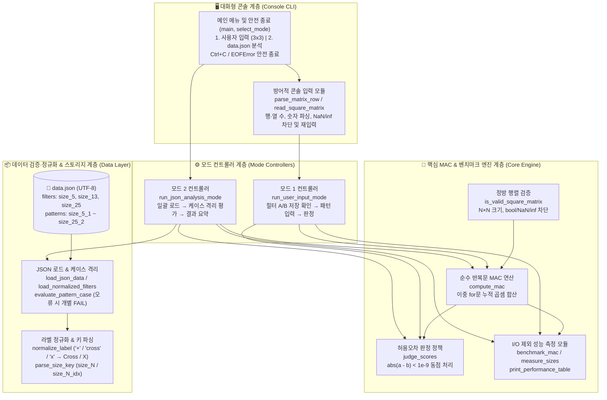

# 🧠 Mini NPU Simulator (MAC 연산 기반 패턴 판별기)

외부 수치 라이브러리(NumPy, pandas 등) 없이 Python 표준 라이브러리와 순수 반복문만으로 **MAC(Multiply-Accumulate) 연산**을 구현하여 $N \times N$ 패턴을 판별하고, 크기별 연산 시간($O(N^2)$)과 부동소수점 비교 정책을 분석하는 콘솔 애플리케이션입니다.

---

## 📑 목차

1. [실행 방법 및 프로젝트 구성](#1-실행-방법-및-프로젝트-구성)
2. [시스템 아키텍처 (Architecture & Structure)](#2-시스템-아키텍처-architecture--structure)
3. [과제 요구사항 체크리스트](#3-과제-요구사항-체크리스트)
4. [단계별 진행 내역 (STEP-by-STEP)](#4-단계별-진행-내역-step-by-step)
5. [구현 요약](#5-구현-요약)
6. [결과 리포트 (실패 원인 & 시간 복잡도 분석)](#6-결과-리포트-실패-원인--시간-복잡도-분석)
7. [과제 목표 핵심 질문 & 답변 (Self-Check)](#7-과제-목표-핵심-질문--답변-self-check)

---

## 1. 실행 방법 및 프로젝트 구성

### 개발 및 실행 환경
- **Python 3.8 이상** (표준 라이브러리 `json`, `math`, `time`, `pathlib`, `typing`만 사용)
- **외부 라이브러리 미사용** (`numpy`, `pandas` 등 금지)

### 주요 파일 구성
- [main.py](main.py): Mini NPU 시뮬레이터 메인 콘솔 애플리케이션
- [data.json](data.json): 모드 2 분석용 필터(`size_5`, `size_13`, `size_25`) 및 패턴 데이터 (`./data.json`)
- [README.md](README.md): 실행 가이드, 아키텍처, 요구사항 점검 및 결과 리포트

### 실행 및 모드 선택
프로젝트 루트 디렉터리에서 아래 명령어로 실행합니다.

```bash
python main.py
```

실행 후 `[모드 선택]` 프롬프트에서 원하는 모드를 입력합니다.
- **`1` (사용자 입력 3x3)**: 3×3 필터 A, B와 3×3 패턴을 한 줄씩(공백 구분) 입력받아 MAC 점수, 평균 연산 시간(10회/ms), 판정(`A`/`B`/`판정 불가`) 및 3×3 성능 표를 출력합니다.
- **`2` (data.json 분석)**: `data.json`을 로드해 모든 패턴 케이스의 MAC 점수, 판정(`Cross`/`X`/`UNDECIDED`), `PASS`/`FAIL`, 크기별(3×3 포함, 5×5/13×13/25×25) 성능 표, 결과 요약을 출력합니다.

---

## 2. 시스템 아키텍처 (Architecture & Structure)

본 프로젝트는 단일 함수에 입출력·연산·데이터 파싱을 몰아넣지 않고, **단일 책임 원칙(Single Responsibility Principle)**에 따라 **대화형 콘솔 계층**, **모드 컨트롤러 계층**, **핵심 MAC·벤치마크 엔진 계층**, **데이터 검증·정규화 및 JSON 스토리지 계층**으로 분리 설계했습니다.



---

## 3. 과제 요구사항 체크리스트

| 구분 | 과제 요구사항 | 구현 함수 / 위치 | 상태 |
| :--- | :--- | :--- | :---: |
| **개발 환경** | Python 3.8+, 외부 라이브러리(NumPy/pandas 등) 미사용 | [main.py](main.py) 표준 라이브러리만 사용 | ✅ |
| **데이터 구조** | $N \times N$ 2차원 패턴/필터 저장, 위치별 접근, 3/5/13/25 지원 | `is_valid_square_matrix()` | ✅ |
| **모드 1 입력** | 3×3 필터 A, B 및 패턴 한 줄씩(공백 구분) 입력 + 저장 확인 | `read_square_matrix()`, `run_user_input_mode()` | ✅ |
| **모드 1 검증** | 행/열 수 불일치, 숫자 파싱 실패 시 안내 출력 및 재입력 유도 | `parse_matrix_row()`, `read_square_matrix()` | ✅ |
| **모드 2 로드** | `data.json`의 `filters(size_N)`와 `patterns(size_{N}_{idx})` 매칭 | `load_json_data()`, `parse_size_key()` | ✅ |
| **모드 2 격리** | 크기/스키마 불일치 시 비정상 종료 없이 해당 케이스만 `FAIL` 처리 | `evaluate_pattern_case()` | ✅ |
| **라벨 정규화** | `'+'`/`'cross'` → `Cross`, `'x'` → `X` 표준 라벨 통일 | `normalize_label()` (`LABEL_ALIASES`) | ✅ |
| **MAC 연산** | 외부 벡터화 라이브러리 없이 반복문으로 곱셈 누적 구현 (`float` 반환) | `compute_mac()` | ✅ |
| **비교 정책** | 허용오차(`epsilon = 1e-9`) 기반 동점(`UNDECIDED`/`판정 불가`) 처리 | `judge_scores()` (`EPSILON = 1e-9`) | ✅ |
| **성능 분석** | I/O 제외 연산 함수 구간 10회 반복 평균(ms) 및 연산 횟수($N^2$) 표 출력 | `benchmark_mac()`, `measure_sizes()`, `print_performance_table()` | ✅ |
| **결과 리포트** | 콘솔 총/통과/실패/실패 사유 출력 + `README` 분석 10줄 이상 서술 | `run_json_analysis_mode()`, [README.md](README.md) | ✅ |
| **보너스(선택)** | 1D 평탄화 비교 및 $N \times N$ 패턴 자동 생성기 | 미진행 (선택 과제 제외) | ➖ |

---

## 4. 단계별 진행 내역 (STEP-by-STEP)

과제를 한 번에 구현하지 않고, 단계별 구현 → 실행 검증 → Git 커밋 순서로 점진적으로 구축했습니다.

| 단계 | 진행 내용 | 검증 결과 | Git 커밋 |
| :--- | :--- | :--- | :--- |
| **STEP 0** | 프로젝트 초기 환경(`Python 3.14.7`) 확인, `.gitignore` 및 `data.json` 구성 | `data.json` 스키마(`meta`, `filters`, `patterns`) 확인 | `0948c1d` |
| **STEP 1** | `main.py` 진입점, 모드 선택 메뉴(`select_mode`), `Ctrl+C`/`EOFError` 안전 종료 골격 구현 | 잘못된 메뉴 입력 재요구 및 `1`/`2`/중단 종료 정상 확인 | `98f4b62` |
| **STEP 2** | `is_valid_square_matrix()`, 이중 반복문 `compute_mac()`, `EPSILON = 1e-9` 기반 `judge_scores()` 구현 | `5.0`/`1.0` 계산, `0.9` vs `0.8999999999999999` 동점 판정, 비정방/bool 행렬 차단 확인 | `5ca0b78` |
| **STEP 3** | I/O를 분리한 `time.perf_counter()` 기반 `benchmark_mac()`(10회 평균), `measure_sizes()`, `print_performance_table()` 구현 | $3\times3, 5\times5, 13\times13, 25\times25$ 평균 시간(ms) 및 $N^2$ 연산 횟수 표 출력 확인 | `6bf216d` |
| **STEP 4** | 모드 1 `parse_matrix_row()`, `read_square_matrix()`, `run_user_input_mode()` 구현 | PDF 예시 정상 입력, 오류 입력(`1 2`, `1 a 0`, 빈 줄, `nan`) 재유도, 동점 판정 모두 통과 | `78ba3b2` |
| **STEP 5** | 모드 2 `normalize_label()`, `parse_size_key()`, `load_normalized_filters()`, `evaluate_pattern_case()`, `run_json_analysis_mode()` 구현 | `data.json` 6개 케이스 분석, 누락/오류 JSON 및 크기 불일치 케이스 개별 `FAIL` 격리 확인 | `6c36432` |
| **STEP 6** | *(선택)* 보너스 과제 (1D 배열 최적화 비교, 패턴 생성기) | 필수 학습 목표 이해에 집중하기 위해 생략 | - |
| **STEP 7** | 모드 1·2 전체 통합 테스트 및 `README.md` 아키텍처·체크리스트·리포트·과제 목표 정리 | 전체 재현성 및 예외 방어 최종 통과 | `74ade35` 이후 업데이트 |

---

## 5. 구현 요약

- **순수 MAC 연산 (`compute_mac`)**: 두 배열의 크기와 유한 숫자 여부를 사전 검증한 뒤, 이중 `for` 반복문으로 각 위치 `(row, col)`의 곱을 누적 합산해 `float` 점수를 반환합니다.
- **라벨 정규화 (`normalize_label`)**: `data.json` 내부에서 필터 키(`'cross'`, `'x'`)와 패턴 `expected` 값(`'+'`, `'x'`)의 표기 형식이 서로 다르므로, 입력 직후 프로그램 내부 표준 라벨인 **`Cross`**와 **`X`** 두 가지로 정규화하여 모든 비교·출력을 일관되게 처리합니다.
- **동점 처리 정책 (`judge_scores`, `EPSILON = 1e-9`)**: 부동소수점 연산에서 발생하는 $10^{-15}$ 수준의 미세 오차로 잘못된 승자가 결정되는 것을 방지하기 위해, `abs(score_a - score_b) < 1e-9`이면 동점(`UNDECIDED` / 모드 1에서는 `판정 불가`)으로 판정합니다.
- **예외 및 스키마 방어**: 모드 1은 잘못된 행 입력 시 해당 줄만 재입력받으며, 모드 2는 파일 오류·JSON 문법 오류·필터 누락·크기 불일치 시 프로그램 전체가 종료되지 않고 케이스 단위로 `FAIL` 사유를 기록합니다.

---

## 6. 결과 리포트 (실패 원인 & 시간 복잡도 분석)

### 6-1. `data.json` 테스트 결과 요약
`python main.py`에서 모드 `2`를 실행한 결과는 다음과 같습니다.

- **총 테스트**: 6개 (`size_5_1`, `size_5_2`, `size_13_1`, `size_13_2`, `size_25_1`, `size_25_2`)
- **통과 (`PASS`)**: 3개 (`size_5_2`, `size_13_1`, `size_25_2`)
- **실패 (`FAIL`)**: 3개 (`size_5_1`, `size_13_2`, `size_25_1`)

| 케이스 | Cross 점수 | X 점수 | 판정 | expected | 결과 |
| :--- | :---: | :---: | :---: | :---: | :---: |
| `size_5_1` | `0.9` | `0.8999999999999999` | `UNDECIDED` | `X` | **FAIL (동점 규칙)** |
| `size_5_2` | `8.9` | `0.1` | `Cross` | `Cross` | **PASS** |
| `size_13_1` | `0.3` | `14.700000000000008` | `X` | `X` | **PASS** |
| `size_13_2` | `7.499999999999997` | `7.5` | `UNDECIDED` | `Cross` | **FAIL (동점 규칙)** |
| `size_25_1` | `4.9` | `4.899999999999999` | `UNDECIDED` | `X` | **FAIL (동점 규칙)** |
| `size_25_2` | `52.9` | `0.1` | `Cross` | `Cross` | **PASS** |

### 6-2. 실패 원인 분석 (데이터/스키마 vs 로직 vs 수치 비교)
실패한 3개 케이스(`size_5_1`, `size_13_2`, `size_25_1`)의 원인을 3가지 관점으로 분리해 진단한 결과는 다음과 같습니다.

1. **데이터/스키마 문제 여부 (해당 없음)**:
   - 모든 필터(`size_5`, `size_13`, `size_25`)와 패턴 행렬이 정상적인 $N \times N$ 정방 행렬로 일치하며, `'+'`/`'cross'`/`'x'` 역시 `Cross`/`X`로 정상 정규화되었습니다.
2. **로직 문제 여부 (해당 없음)**:
   - `size_5_1`의 X 패턴은 수학적으로 Cross 필터에서 `0.9`(중앙 1칸), X 필터에서 `0.1 × 9 = 0.9`를 얻어야 하며, `size_13_2`의 Cross 패턴은 Cross 필터에서 `0.3 × 25 = 7.5`, X 필터에서 `7.5`(중앙 1칸)를 얻어야 합니다. `compute_mac()`은 각 위치의 곱셈·덧셈을 정확히 수행했습니다.
3. **수치 비교 문제 — 부동소수점 누적 오차 및 `epsilon` 동점 정책 (핵심 원인)**:
   - `0.1`과 `0.3`은 IEEE-754 2진 부동소수점으로 정확히 표현되지 않아 반복 덧셈 과정에서 `0.8999999999999999`(vs `0.9`), `7.499999999999997`(vs `7.5`), `4.899999999999999`(vs `4.9`)처럼 약 $10^{-16} \sim 10^{-15}$ 수준의 미세 오차가 발생합니다.
   - 만약 허용오차 없이 단순 비교(`score_cross > score_x`)를 썼다면, 수학적으로 **완전한 동점**임에도 `size_5_1`과 `size_25_1`은 `Cross`로, `size_13_2`는 `X`로 오판하게 됩니다.
   - 본 시뮬레이터는 `abs(score_cross - score_x) < 1e-9`일 때 동점(`UNDECIDED`)으로 판정하는 정책을 적용했으므로, `expected`(`X` 또는 `Cross`)와 달라 규칙대로 `FAIL (동점 규칙)`으로 분류되었습니다.

### 6-3. 성능 표 해석 및 시간 복잡도 $O(N^2)$ 분석
`benchmark_mac()`은 파일 읽기나 콘솔 `print()` 같은 I/O 시간을 완전히 제외한 상태에서 순수 `compute_mac()` 호출만 `time.perf_counter()`로 크기별 10회 반복 측정해 평균을 산출했습니다.

| 크기 ($N \times N$) | 평균 시간 (ms, 10회 평균) | 연산 횟수 ($N^2$) | $3 \times 3$ 대비 연산 배율 |
| :---: | :---: | :---: | :---: |
| `3×3` | `0.0062` | `9` | `1.0×` |
| `5×5` | `0.0119` | `25` | `2.8×` |
| `13×13` | `0.1038` | `169` | `18.8×` |
| `25×25` | `0.2752` | `625` | `69.4×` |

- **이론적 근거 ($O(N^2)$)**: `compute_mac()`은 크기 $N$에 대해 바깥 `for row in range(N)` 루프 $N$번 × 안쪽 `for col in range(N)` 루프 $N$번 = 총 $N^2$회의 곱셈·누적 연산을 수행하므로 시간 복잡도는 **$O(N^2)$**입니다.
- **실측 결과와의 연결**: $3 \times 3 \to 25 \times 25$로 한 변의 크기 $N$은 약 `8.3배` 커지지만 연산 횟수는 $9 \to 625$로 약 `69.4배` 증가합니다. 실측 평균 시간 역시 `0.0062 ms → 0.0119 ms → 0.1038 ms → 0.2752 ms`로 연산 횟수($N^2$) 증가에 따라 약 `44.4배`까지 가파르게 상승하여 $O(N^2)$ 증가 추세를 실측으로 확인했습니다. *(소형 크기에서는 함수 호출·검증 같은 고정 오버헤드 비중 때문에 배율이 다소 완만하게 나타납니다.)*

---

## 7. 과제 목표 핵심 질문 & 답변 (Self-Check)

과제 명세의 **「3. 과제 목표」** 6가지 항목에 대한 핵심 정리입니다.

### Q1. MAC(Multiply-Accumulate) 연산이 무엇이고, AI에서 왜 중요한가요?
- **정의**: 두 숫자 배열에서 같은 위치에 있는 값끼리 **곱하고(Multiply)**, 그 결과를 하나의 합계에 **누적해서 더하는(Accumulate)** 연산입니다.
- **AI에서 중요한 이유**: 이미지 인식·신경망 추론에서 입력 데이터와 수많은 필터(가중치)의 곱셈-누적 합산이 전체 연산의 대부분을 차지합니다. 필터 크기와 개수가 커질수록 MAC 연산량이 기하급수적으로 늘어나므로, 이를 병렬로 빠르게 처리하는 AI 전용 칩(NPU)의 핵심 연산 단위가 됩니다.

### Q2. 입력 패턴과 필터를 곱하고 더해서 유사도(점수)를 계산하는 원리는 무엇인가요?
- 필터는 특정 모양(예: 십자가 위치에 높은 값, 배경에 `0`)을 숫자로 정의한 기준표입니다.
- 입력 패턴과 필터를 겹쳐 위치별 곱셈을 하면 **모양이 일치하는 칸에서는 양수 값이 크게 누적**되고, 겹치지 않는 칸은 `0`이 곱해져 점수에 기여하지 않습니다. 따라서 여러 필터 중 **MAC 점수가 더 높은 필터**를 해당 입력 패턴과 가장 유사한 모양으로 판정할 수 있습니다.

### Q3. `data.json`의 "키 규칙/라벨 규칙"은 무엇이고, 프로그램 내부에서 라벨을 표준화(정규화)하는 이유는 무엇인가요?
- **규칙 해석**: `filters`는 `"size_5"`, `"size_13"`, `"size_25"` 아래에 `"cross"`, `"x"` 키를 사용하고, `patterns`는 `"size_{N}_{idx}"` 키 아래에 `"expected": "+"` 또는 `"x"`를 사용합니다.
- **정규화 이유**: 같은 십자가 모양을 한쪽은 `"cross"`, 다른 쪽은 `"+"`로 표기하고 있어, 표준화 없이 문자열을 그대로 비교하면 `'cross' != '+'` 때문에 정상 판정도 `FAIL`로 처리됩니다. 입력 시점에 내부 표준 라벨(`Cross`, `X`)로 통일하면 비교 로직과 출력 형식을 단순하고 일관되게 유지할 수 있습니다.

### Q4. 부동소수점 오차가 판정에 어떤 영향을 주며, 허용오차(`epsilon`) 기반 비교 정책이 왜 필요한가요?
- **영향**: `0.1`, `0.3` 같은 10진 소수를 컴퓨터의 2진 부동소수점으로 표현·누적하면 `0.8999999999999999`(vs `0.9`)나 `7.499999999999997`(vs `7.5`)처럼 $10^{-16} \sim 10^{-15}$ 수준의 미세 오차가 생깁니다.
- **필요성**: 수학적으로 완전히 같은 점수라도 단순 비교(`>` 또는 `==`)를 쓰면 오차 방향에 따라 우연한 승자가 결정되어 오판이 발생합니다. `abs(a - b) < 1e-9` 같은 허용오차(`epsilon`) 정책을 두어야 수치 잡음에 흔들리지 않고 동점(`UNDECIDED`)을 정확히 걸러낼 수 있습니다.

### Q5. 크기별 연산 시간을 측정할 때, 패턴 크기 증가에 따른 시간 복잡도 $O(N^2)$를 어떻게 근거와 함께 설명하나요?
- I/O(`print`, 파일 읽기)를 제외한 순수 `compute_mac()`만 측정했을 때, $N \times N$ 행렬은 `row` $N$회 × `col` $N$회 = **$N^2$회** 반복문을 수행합니다.
- 실제로 $3 \times 3(9\text{회}) \to 5 \times 5(25\text{회}) \to 13 \times 13(169\text{회}) \to 25 \times 25(625\text{회})$로 연산 횟수가 약 `69.4배` 늘어날 때 평균 실행 시간도 `0.0062 ms → 0.2752 ms`로 비례해 증가하므로, 실행 시간이 $N^2$에 비례하는 **$O(N^2)$** 복잡도를 가짐을 실측으로 증명할 수 있습니다.

### Q6. 실패 케이스가 발생했을 때 원인을 "데이터/스키마 문제 vs 로직 문제 vs 수치 비교 문제"로 어떻게 분리해 진단하고 개선하나요?
- **1단계 (데이터/스키마 점검)**: 행렬 크기 불일치, 필수 키 누락, 라벨 표기 불일치(`'+'` vs `'cross'`) 여부를 먼저 확인합니다. (→ 스키마 검증 및 라벨 정규화로 개선)
- **2단계 (로직 점검)**: 손으로 계산한 기대 점수와 `compute_mac()` 출력값이 일치하는지 확인합니다. (→ 반복문 인덱스 및 누적 로직 검증)
- **3단계 (수치 비교 점검)**: 점수는 이론값과 같으나 $10^{-15}$ 차이로 판정이 갈린다면 부동소수점 오차와 `epsilon` 비교 정책의 결과입니다. (→ `epsilon` 기준 유지 및 동점 원인 리포트 명시, 또는 필요 시 필터 가중치 재설계로 동점 자체를 해소)
